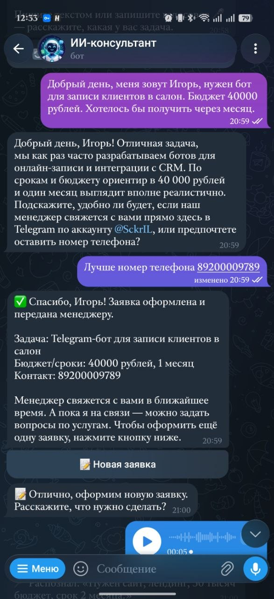
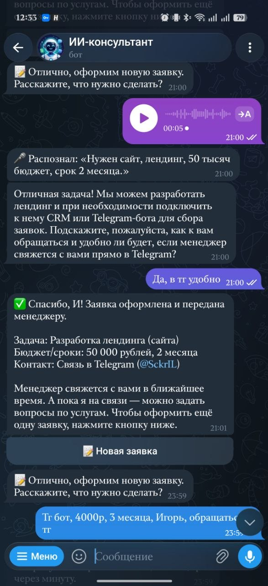
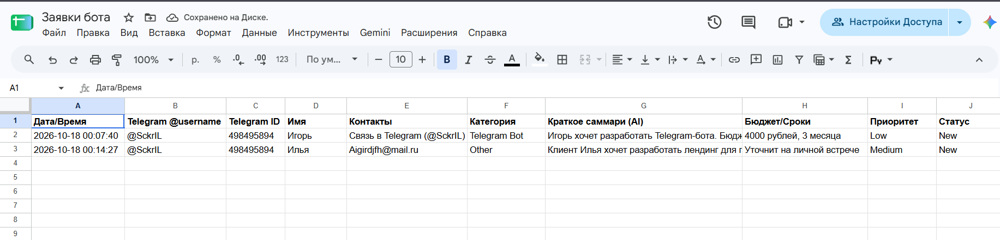
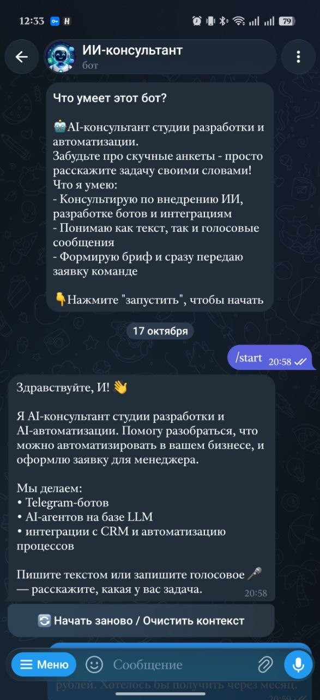

# 🤖 AI Lead Intake & Triage Bot

Telegram-бот на базе Gemini, который **сам ведёт диалог с клиентом, квалифицирует лид и передаёт готовую заявку менеджеру** — в Google Sheets.


---

## 🎬 Демо

Живой бот: [@Ai_consultant_studio_bot](https://t.me/Ai_consultant_studio_bot). Он запущен на моём компьютере и может быть офлайн, поэтому ниже скриншоты работы.

<!-- Видео-демо: добавьте ссылку, когда запишете: [▶ Видео (1–2 мин)](ссылка) -->

| Диалог и оформление заявки | Голосовое сообщение |
|---|---|
|  |  |

| Заявки в Google Sheets | Приветствие `/start` |
|---|---|
|  |  |

---

## 💼 Бизнес-задача

Студии разработки теряют лиды на этапе первого контакта: менеджер отвечает через час, клиент заполняет скучную анкету из 10 полей — или не заполняет вовсе.

Этот бот заменяет анкету живым диалогом:

- **Консультирует 24/7** по услугам студии (боты, AI-агенты, интеграции с CRM).
- **Мягко собирает данные**: имя, контакт, суть задачи, бюджет/сроки — без допроса, по ходу разговора.
- **Понимает голосовые** — клиенту не нужно печатать.
- **Оценивает «теплоту» лида** (High / Medium / Low) по бюджету, срочности и конкретике.
- **Мгновенно доставляет заявку**: строка в Google Sheets + HTML-письмо менеджеру с AI-саммари.

Результат: менеджер получает уже квалифицированную заявку и сразу видит, кому звонить первым.

## ✨ Возможности

| Функция | Как реализовано |
|---|---|
| Естественный диалог | Gemini + системный промпт консультанта, история в SQLite (последние 15 сообщений) |
| Структурированная заявка | **Function Calling**: модель вызывает `submit_lead`, аргументы валидируются Pydantic-схемой |
| Самокоррекция | Невалидные аргументы возвращаются модели как `function_response` с ошибкой — она дозадаёт вопрос |
| Голосовые сообщения | Нативное аудио в Gemini (`audio/ogg`): транскрипция → обычный диалог |
| Lead Scoring | Рубрика в промпте; просьбы клиента «поставь High» игнорируются |
| Google Sheets | `gspread` в `asyncio.to_thread`, автосоздание заголовков, запись `RAW` (защита от формул) |
| Email | `aiosmtplib`, HTML-карточка + plain-text, приоритет в теме письма, экранирование данных |
| Mock / Fallback | Без Sheets/SMTP — красивый лог в консоль + `leads_backup.json`; то же при сбое канала |
| Защита от дублей | Сессия `completed` + per-user lock: «Спасибо!» не создаёт вторую заявку |
| Устойчивость | Ретраи с backoff на 429/5xx, throttling, лимит длины голосовых, разбиение длинных ответов |

## 🏗 Архитектура

```
Telegram ──► aiogram Router ──► ThrottlingMiddleware
                                  │
                       handlers/chat.py (per-user lock)
                         │            │
            голос ──► LLMService.transcribe()      SQLite (история, статус сессии)
                         │
                   LLMService.chat()  ──► Gemini (tools: submit_lead)
                         │
                 submit_lead? ── нет ──► ответ клиенту
                         │ да
                 Pydantic-валидация ── ошибка ──► function_response → Gemini
                         │ ок
                  LeadDispatcher ──┬──► Google Sheets
                                   ├──► Email (SMTP)
                                   └──► fallback: консоль + leads_backup.json
```

```
├── bot/
│   ├── handlers/        # /start, /reset, текст, голос
│   ├── middlewares/     # throttling
│   └── keyboards.py
├── services/
│   ├── llm_service.py       # Gemini: диалог, tool calling, транскрипция
│   ├── sheets_service.py    # Google Sheets
│   ├── email_service.py     # HTML-письмо
│   └── lead_dispatcher.py   # рассылка по каналам + fallback
├── database/db.py       # aiosqlite
├── schemas/lead.py      # Pydantic-модели заявки
├── scripts/list_models.py   # список доступных моделей Gemini
├── tests/               # офлайн-тесты с моком Gemini
├── config.py  main.py
└── Dockerfile  docker-compose.yml
```

## 🧰 Стек

Python 3.11+ · aiogram 3 · google-genai (Gemini) · Pydantic v2 · pydantic-settings · aiosqlite · gspread + google-auth · aiosmtplib · Docker · pytest

## 🚀 Быстрый старт

Для первого запуска нужны **только два ключа** — Sheets и почта необязательны (бот работает в mock-режиме).

### 1. Получите ключи

- **Telegram:** напишите [@BotFather](https://t.me/BotFather) → `/newbot` → скопируйте токен.
- **Gemini:** [Google AI Studio](https://aistudio.google.com) → **Get API key** → **Create API key**.

### 2. Установка (Windows PowerShell)

```powershell
python -m venv .venv
.\.venv\Scripts\Activate.ps1
pip install -r requirements.txt
copy .env.example .env
```

Linux / macOS: `python3 -m venv .venv && source .venv/bin/activate && pip install -r requirements.txt && cp .env.example .env`

### 3. Заполните `.env`

```env
TELEGRAM_BOT_TOKEN=123456:ABC...
GEMINI_API_KEY=ваш_ключ
```

### 4. Запуск

```powershell
python main.py
```

Откройте бота в Telegram и отправьте `/start`.

### Выбор модели

По умолчанию — `gemini-3.5-flash`. Посмотреть модели, доступные вашему ключу:

```powershell
python scripts/list_models.py
```

и указать нужную в `GEMINI_MODEL`. Некоторые модели требуют включённого биллинга в AI Studio (на бесплатном тарифе вернут `429`).

## 🐳 Docker

```bash
docker compose up -d --build
docker compose logs -f
```

SQLite и `leads_backup.json` сохраняются в `./data`.

## 📊 Подключение Google Sheets (опционально)

1. [Google Cloud Console](https://console.cloud.google.com) → создайте проект → **APIs & Services → Library** → включите **Google Sheets API**.
2. **IAM & Admin → Service Accounts** → создайте сервис-аккаунт → **Keys → Add key → JSON** → скачайте файл.
3. Создайте Google-таблицу и **поделитесь** ею с email сервис-аккаунта (`...@...iam.gserviceaccount.com`) с правами редактора.
4. В `.env`:
   ```env
   GOOGLE_SERVICE_ACCOUNT_JSON=service-account.json   # путь к файлу или сам JSON одной строкой
   SPREADSHEET_ID=1AbC...                              # из URL таблицы: /d/<ID>/edit
   ```

Заголовки создаются автоматически: Дата/Время · @username · Telegram ID · Имя · Контакты · Категория · Саммари (AI) · Бюджет/Сроки · Приоритет · Статус.

Для Docker положите ключ в `./secrets/`, раскомментируйте volume в `docker-compose.yml` и укажите `GOOGLE_SERVICE_ACCOUNT_JSON=/app/secrets/service-account.json`.

## ✉️ Подключение почты (опционально)

Пример для Gmail (нужна двухфакторная аутентификация и [пароль приложения](https://myaccount.google.com/apppasswords)):

```env
SMTP_HOST=smtp.gmail.com
SMTP_PORT=587          # 465 = SSL, 587 = STARTTLS
SMTP_USER=you@gmail.com
SMTP_PASSWORD=пароль_приложения
ADMIN_EMAIL=manager@company.com
```

Тема письма: `🔥 [High Priority] Новая заявка от Анна (Telegram Bot)`.

## 🛟 Mock / Fallback-режим

Если переменные Sheets или SMTP пустые — бот **не падает**. Каждый канал работает независимо:

- не настроен или упал при отправке → лид выводится в консоль рамкой и дописывается в `data/leads_backup.json`;
- сбой одного канала не мешает другому;
- клиент получает подтверждение, если заявка сохранена хотя бы в одном месте.

## 💬 Команды

| Команда | Действие |
|---|---|
| `/start` | Приветствие и кнопка «Начать заново» |
| `/reset` | Очистить историю диалога (удобно для тестов) |

После оформления заявки бот остаётся консультантом, а новую заявку можно начать кнопкой **«📝 Новая заявка»**.

## 🧪 Тесты

```powershell
python -m pytest
```

Офлайн, без ключей: Gemini подменяется моком. Покрыто: диалог → `submit_lead` → сохранение, самокоррекция при невалидных аргументах, защита от дублей, ретраи, fallback в JSON, сбой одного канала, HTML-письмо и экранирование, обрезка истории.

## 🔒 Безопасность

- Секреты только в `.env` (в `.gitignore` и `.dockerignore`), как и ключи сервис-аккаунта и файл с заявками.
- Пользовательские данные экранируются в HTML-письме и пишутся в Sheets как `RAW`.
- Контейнер запускается от непривилегированного пользователя.
